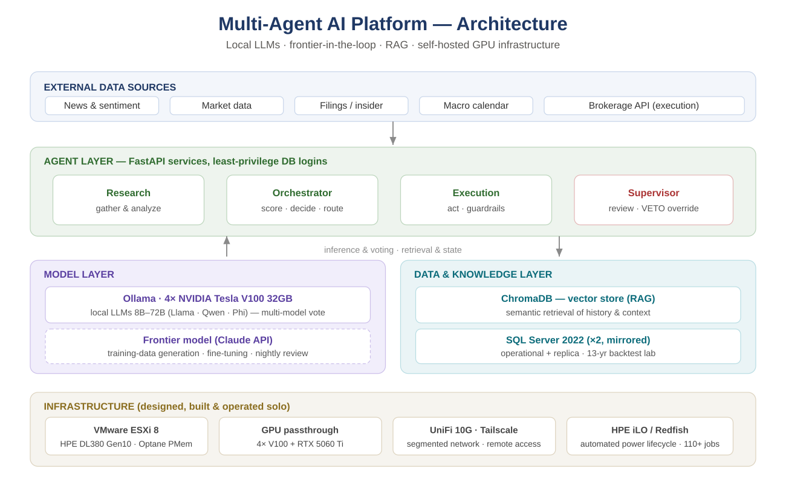

# Architecture

**Flow:** external data sources feed the **agent layer** (research → orchestrator → execution, with an independent supervisor). Agents call the **model layer** — local LLMs on Ollama across 4× Tesla V100, plus a frontier model (Claude API) for training-data generation, fine-tuning, and nightly review — and the **data & knowledge layer** (ChromaDB vector store for RAG, dual mirrored SQL Server 2022). Everything runs on self-hosted **VMware ESXi 8** infrastructure with GPU passthrough, segmented networking, and automated power management.

See the repository [README](../README.md) for the full write-up.
